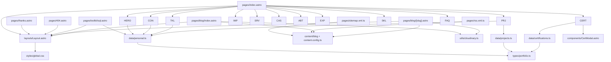

# PROJECT_MAP — Mapa del repositorio

## Objetivo

Ofrecer un mapa completo y navegable del repositorio: árbol de carpetas, propósito de cada directorio, dependencias entre módulos y componentes críticos.

## Alcance

Estructura de archivos versionados (`git ls-files`: 92 archivos) y carpetas locales relevantes. No documenta el contenido interno de `node_modules` ni de `dist`.

## Árbol completo

```
Portafolio-HTML/
├── .ai/                              # Documentación canónica para agentes
│   ├── agents/                       # Protocolo operativo y guías por herramienta
│   └── diagrams/                     # Diagramas Mermaid (arquitectura, componentes, despliegue, flujo)
├── .github/
│   └── workflows/
│       └── deploy-pages.yml          # CI/CD: verificación, tests, build y deploy
├── .astro/                           # Generado por Astro (ignorado)
├── dist/                             # Salida del build (ignorada, 35 archivos)
├── node_modules/                     # Dependencias (ignorado)
├── public/                           # Assets copiados tal cual a la raíz de dist/
│   ├── .nojekyll                     # Desactiva Jekyll en GitHub Pages
│   ├── .well-known/
│   │   └── security.txt              # RFC 9116 (idéntico a public/security.txt)
│   ├── assets/
│   │   └── cv/
│   │       ├── cv-juan-samayoa-es.pdf
│   │       └── cv-juan-samayoa-en.pdf
│   ├── CNAME                         # juan-samayoa.is-a.dev
│   ├── _headers                      # CSP, HSTS y caché para hosts compatibles
│   ├── apple-touch-icon.png          # 180×180
│   ├── favicon.ico                   # 256×256
│   ├── manifest.json                 # PWA manifest (duplicado)
│   ├── og-image.png                  # 1200×630; usado por /thanks y /404
│   ├── robots.txt                    # Reglas + bloqueo de crawlers de IA + sitemap
│   ├── security.txt                  # RFC 9116 en raíz
│   ├── site.webmanifest              # PWA manifest enlazado por el Layout
│   └── sw.js                         # Service worker publicado, no registrado
├── scripts/                          # LOCAL, ignorado por git
├── src/
│   ├── components/                   # 13 componentes Astro
│   │   ├── About.astro               # Sobre mí + proceso QA
│   │   ├── Cases.astro               # 2 casos de éxito
│   │   ├── CertModal.astro           # Modal <dialog> de certificaciones (386 líneas)
│   │   ├── Certifications.astro      # Grid destacadas + <details> adicionales
│   │   ├── Contact.astro             # Formulario FormSubmit + enlaces + CVs
│   │   ├── Experience.astro          # Timeline de 5 roles
│   │   ├── Faq.astro                 # 7 <details> con preguntas
│   │   ├── Hero.astro                # Portada + tarjeta terminal + métricas
│   │   ├── Impact.astro              # 4 métricas de impacto
│   │   ├── Projects.astro            # Grid de proyectos desde datos
│   │   ├── Services.astro            # 4 servicios
│   │   ├── Skills.astro              # 4 categorías de stack
│   │   └── Toolkit.astro             # 4 recursos
│   ├── content/
│   │   └── blog/
│   │       └── arquitectura-portafolio-astro.md  # 1 artículo publicado
│   ├── data/
│   │   ├── certifications.ts         # 22 certificaciones + vistas derivadas
│   │   ├── personal.ts               # Datos personales, redes, CVs
│   │   └── projects.ts               # 5 proyectos
│   ├── layouts/
│   │   └── Layout.astro              # Head SEO/seguridad/RSS + nav + footer + scripts
│   ├── pages/
│   │   ├── 404.astro                 # Página de error (noindex)
│   │   ├── index.astro               # Home: composición de 12 secciones
│   │   ├── blog/
│   │   │   ├── index.astro           # Índice del blog con filtro por tags
│   │   │   └── [slug].astro          # Artículo con BlogPosting y pie de acciones
│   │   ├── rss.xml.ts                # Feed RSS desde la colección
│   │   ├── sitemap.xml.ts            # Sitemap desde la colección
│   │   ├── thanks.astro              # Confirmación de formulario
│   │   └── toolkit/
│   │       └── sql.astro             # SQL Validation Playground (5 ejemplos)
│   ├── styles/
│   │   └── global.css                # Sistema visual (2 278 líneas)
│   ├── types/
│   │   └── portfolio.ts              # PersonalInfo, Badge, Project, Certification
│   ├── utils/
│   │   └── cloudinary.ts             # Transformaciones f_auto,q_auto
│   ├── content.config.ts             # Esquema de la colección `blog`
│   └── env.d.ts                      # Referencias de tipos de Astro
├── tests/
│   ├── local-references.test.mjs     # 6 pruebas Node del comprobador de referencias
│   ├── phase1.spec.ts                # Navegación, modal, contraste, viewports
│   ├── phase2.spec.ts                # Foco, no-JS, movimiento reducido
│   └── phase3.spec.ts                # Hero, anclas absolutas, menú en rutas auxiliares
├── tools/
│   └── check-local-references.mjs    # Verifica referencias locales del HTML en dist/
├── .gitignore
├── .pages.yml                        # Pages CMS: colección `blog` y campos
├── AGENTS.md                         # Punto de entrada (enruta a .ai/)
├── CLAUDE.md                         # Punto de entrada por herramienta
├── CODEX.md                          # Punto de entrada por herramienta
├── README.md                         # Inventario de alto nivel del repositorio
├── astro.config.mjs                  # site, base, outDir, security, build, Vite
├── package.json                      # Scripts, deps, packageManager
├── playwright.config.ts              # Preview 5173, Chrome local / Chromium en CI
├── pnpm-lock.yaml
├── pnpm-workspace.yaml               # Overrides de seguridad y minimumReleaseAge
├── tailwind.config.cjs               # Config mínima (no define el diseño)
└── tsconfig.json                     # strict, bundler, esnext
```

## Propósito de cada directorio

| Directorio | Propósito | Se versiona | Se publica |
|---|---|---|---|
| `.ai/` | Fuente de verdad documental para agentes | Sí | No |
| `.github/workflows/` | Verificación, tests y despliegue | Sí | No |
| `public/` | Assets estáticos y archivos de control del hosting | Sí | Sí, copiados a la raíz |
| `src/components/` | Presentación por sección, sin lógica de negocio | Sí | Compilado |
| `src/content/blog/` | Artículos Markdown de la colección | Sí | Genera HTML |
| `src/data/` | Contenido estructurado y tipado | Sí | Compilado |
| `src/layouts/` | Shell HTML, SEO, seguridad y comportamiento global | Sí | Compilado |
| `src/pages/` | Routing por archivos y endpoints | Sí | Genera HTML/XML |
| `src/styles/` | Sistema visual único | Sí | CSS con hash |
| `src/types/` | Contratos TypeScript | Sí | No |
| `src/utils/` | Utilidades puras compartidas | Sí | Compilado |
| `tests/` | Suite E2E y pruebas Node | Sí | No |
| `tools/` | Scripts de verificación sin dependencias | Sí | No |
| `scripts/` | Utilidades locales de despliegue manual | **No** (`.gitignore`) | No |
| `docs/` | Borradores locales | **No** (`.gitignore`) | No |
| `dist/` | Artefacto de build | No | Es lo que se publica |
| `.astro/` | Tipos generados | No | No |

## Dependencias entre módulos



## Dependencias de build y runtime

| Tipo | Elemento | Notas |
|---|---|---|
| Runtime npm | `astro`, `@astrojs/rss` | Producción |
| Dev npm | `@astrojs/check`, `@playwright/test`, `@tailwindcss/postcss`, `@tailwindcss/vite`, `postcss`, `tailwindcss`, `typescript` | Compilación, tipos, CSS y pruebas |
| Runtime navegador | APIs nativas | `IntersectionObserver`, `requestAnimationFrame`, `navigator.clipboard`, `Blob`, `<dialog>`, `<details>` |
| Externas | Cloudinary, Google Fonts, FormSubmit, GitHub Pages, Pages CMS | Sin fallback local para imágenes |

## Componentes críticos

| Componente | Criticidad | Motivo |
|---|---|---|
| `src/layouts/Layout.astro` | Muy alta | SEO, CSP, RSS, navegación, footer y scripts globales en un solo archivo |
| `src/pages/index.astro` | Alta | Orden narrativo de las 12 secciones y metadatos de la home |
| `src/styles/global.css` | Alta | Todo el diseño de las secciones; un error afecta a todas las rutas |
| `src/data/personal.ts` | Alta | Contacto, redes, foto y CVs; alimenta también `security.txt` conceptualmente |
| `src/components/Contact.astro` | Alta | Único formulario y canal principal de conversión |
| `src/content.config.ts` + `.pages.yml` | Alta | Contrato del blog: un campo desalineado rompe la publicación |
| `src/pages/blog/[slug].astro` | Alta | Render de artículos, `BlogPosting`, portada y metadatos |
| `src/components/Certifications.astro` + `CertModal.astro` | Media-alta | Acoplamiento por `CustomEvent("open-cert-modal")`; accesibilidad por teclado |
| `src/data/certifications.ts` | Media | `category` omitido ⇒ certificación invisible |
| `src/pages/toolkit/sql.astro` | Media | 628 líneas con datos, markup, scripts y estilos encapsulados |
| `astro.config.mjs` | Media | `site`, `base`, hashes de assets y cabeceras de desarrollo |
| `public/_headers`, `public/sw.js` | Media | Seguridad y caché; fáciles de desincronizar |
| `.github/workflows/deploy-pages.yml` | Alta | Único camino de publicación |

## Archivos y referencias notables

| Referencia | Origen | Estado |
|---|---|---|
| `/og-image.png` | `thanks.astro`, `404.astro` | Existe en `public/` |
| `/rss.xml` | autodiscovery en `Layout.astro`, `blog/index.astro` | Generado por `rss.xml.ts` |
| `/sitemap.xml` | `public/robots.txt` | Generado por `sitemap.xml.ts`; ya no hay archivo estático |
| `public/assets/img/`, `public/assets/icons/` | `sw.js` (patrones de caché) | No existen; el worker no se registra |
| `manifest.json` / `site.webmanifest` | `public/` | Duplicados; el Layout enlaza `site.webmanifest` |

## Reglas

- Un archivo nuevo debe tener un propósito claro y ubicarse en el directorio que corresponde a su capa.
- No se versionan artefactos (`dist/`, `.astro/`) ni dependencias.
- Los cambios en `public/` se publican tal cual: no hay compilación ni validación de su contenido.
- Toda referencia a un asset debe poder resolverse dentro de `public/` o ser un endpoint del build.
- Los artículos nuevos van a `src/content/blog`, nunca a `src/pages`.

## Ejemplos reales

- Cadena de import típica: `pages/index.astro` → `components/Projects.astro` → `data/projects.ts` → `types/portfolio.ts`.
- Un proyecto nuevo se añade solo en `src/data/projects.ts`; `Projects.astro` lo renderiza sin cambios.
- Un artículo nuevo se añade solo en `src/content/blog`; índice, sitemap y RSS lo recogen sin tocar código.
- Archivo ignorado pero presente: `scripts/deploy-github.sh` no aparece en `git ls-files`.

## Riesgos conocidos

- `src/pages/toolkit/sql.astro` concentra datos, SEO, markup, comportamiento y estilos, y es el archivo con mayor coste de mantenimiento.
- `global.css` es un único punto de fallo visual para todo el sitio.
- `Layout.astro` mezcla SEO, seguridad, navegación y comportamiento; tocarlo tiene efecto transversal.
- La carpeta `scripts/` genera confusión: existe, parece parte del proyecto, no está versionada.

## Recomendaciones futuras

- Extraer los ejemplos SQL a `src/data/sql-examples.ts` para alinear la página con la separación datos/presentación.
- Dividir `global.css` por secciones solo si el tamaño sigue creciendo, manteniendo un único punto de entrada.
- Eliminar o documentar formalmente `scripts/` para evitar ambigüedad operativa.
- Documentar el flujo de edición del blog con Pages CMS en un único lugar.
